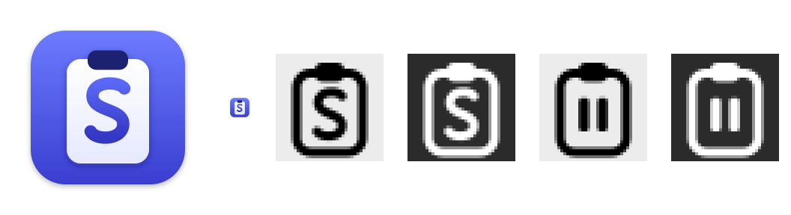

# Icons

One identity for the app icon and the menu bar icon: a **clipboard whose board carries an "S"**.

## Concepts considered

| | Concept | Verdict |
|---|---|---|
| **A** | Clipboard silhouette with a bold, rounded "S" stroke on the board | **Chosen.** Reads as "clipboard" first and "Supercy" second; the "S" survives at 16 px; the same silhouette works as a one-ink menu bar template, and swapping the "S" for pause bars gives the paused state without a new shape |
| B | Two stacked cards (history) with a small spark | Reads as "history" but not as clipboard; the spark turns to noise below 32 px; weak as a template |
| C | Clipboard with a pin in the clip | Ties to pins and pin-to-screen, but the pin is too small at menu bar size and is easily mistaken for a location marker |

## App icon (`design/icons/app-icon.svg`)

- Grid: Apple's macOS template — 1024 × 1024 canvas, 824 × 824 rounded square at (100, 100), corner radius 185; the margin holds the drop shadow.
- Canvas: vertical gradient `#6C7BFF` → `#3A3ED0`, soft shadow (offset 10, blur 14, 28 % black).
- Board: 440 × 560 at (292, 252), radius 76, white → `#E6E9FF`; clip 216 × 104, radius 46, `#1E2270`; shadow tinted `#14185E`.
- Mark: one rounded "S" stroke, width 66, gradient `#5A68F5` → `#3337C2`, centred on the board.
- Works on light and dark desktops: the blue canvas carries its own contrast; no transparency inside the square.
- Sizes: 16, 32, 128, 256, 512 at @1x and @2x (`AppIcon.appiconset`).

## Menu bar icon (`design/icons/menubar*.svg`)

- 18 × 18 pt template images (@1x 18 px, @2x 36 px), one ink (black), marked as templates in the asset catalog so macOS tints them for light, dark and highlighted menu bars.
- Board outline 1.5 pt, clip filled, "S" stroke 1.5 pt with round caps — the app icon's shapes, simplified.
- States: `MenuBarIcon` (recording) and `MenuBarIconPaused` (pause bars instead of the "S").
- The icon-style setting offers this mark (default) or a system paper clip, scissors or stack symbol.

## Rendering

The SVG files are the source of truth. `scripts/docker-test.sh icons` renders them in a Debian container with
librsvg and ImageMagick (`design/icons/render.sh`) into `apps/macos/Resources/Assets.xcassets` and this page's
review sheet; nothing is installed on the host. The PNGs are committed.
